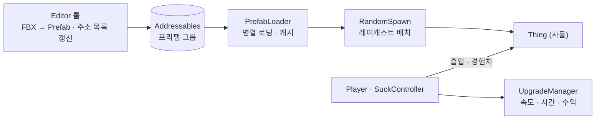

# 🧹 Giant Vacuum Cleaner

> 주변 사물을 빨아들여 몸집을 키우고, 점점 더 큰 사물을 빨아들이는 3D 하이퍼캐주얼 성장 게임
> **ActionFit 인턴십**에서 기획 1 · 아트 1 · 개발 1(본인) 구성으로 클라이언트 개발 전체를 맡았습니다.

[](https://www.youtube.com/shorts/lMh7qx2Snk4)

**[▶️ 시연 영상](https://www.youtube.com/shorts/lMh7qx2Snk4)**

## 한눈에 보기

| 항목 | 내용 |
| --- | --- |
| 기간 / 인원 | 2024.07 \~ 2024.08 / 3명 (기획 1, 아트 1, 개발 1) · ActionFit 인턴십 |
| 장르 / 플랫폼 | 3D 하이퍼캐주얼 성장 / Android (미출시) |
| 내 역할 | 클라이언트 개발 전체 (게임플레이, 랜덤 배치, 리소스 로딩, 에디터 툴) |
| 기술 스택 | **Unity · C# · URP** · Addressables · UniTask · DOTween · Cinemachine |

## 내가 해결한 것

**1. 아트 리소스 → 프리팹 변환 자동화 에디터 툴**
- FBX 폴더를 선택하면 하위 메시마다 템플릿 기반 프리팹 생성, 메시·머티리얼 복사와 바운드 기반 `BoxCollider` 자동 맞춤
- FBX 51개에서 프리팹 약 1,300개를 손작업 없이 생성 (폴더 기준 추정치), 씬 오브젝트를 이름으로 프리팹 인스턴스로 재연결하는 툴 추가

**2. Addressables 기반 리소스 로딩**
- 프리팹 그룹을 enum으로 관리하고, 에디터 메뉴 한 번으로 주소 목록 ScriptableObject 자동 갱신
- 런타임 `UniTask.WhenAll` 병렬 로딩과 캐싱, 로딩 완료 후 랜덤 배치 시작

**3. 질량 차이 기반 흡입 물리**
- 트리거 Enter/Exit로 흡입 후보 관리, 레벨 조건을 만족한 대상에만 `FixedUpdate`에서 힘 적용
- 플레이어와 대상의 질량 차이에 비례한 흡입력, 레벨업 시 후보 재평가

## 구조



> [!WARNING]
> 회사 내부 프레임워크와 SDK 코드를 제외하고 공개한 저장소라 **이 상태로는 빌드되지 않습니다.** 직접 작성한 게임 코드와 에디터 툴을 확인하는 용도입니다.

---

## 상세 내용

<details>
<summary><b>🛠 주요 구현</b></summary>

### 1. FBX → Prefab 자동 변환

📁 `Assets/Editor/FBXToPreFab.cs`, `Assets/Editor/ReconnectPrefab.cs`

아트 팀이 사물들을 FBX 하나에 여러 개씩 묶어 전달해, 사물마다 프리팹을 만들고 콜라이더를 맞추는 반복 작업이 필요했습니다.

- FBX 폴더 선택 → FBX의 하위 오브젝트마다 템플릿 프리팹을 복제해 메시·머티리얼을 복사
- 메시 바운드에 맞춰 `BoxCollider` 크기·중심 자동 설정
- `ReconnectPrefab`: 이미 씬에 배치된 오브젝트를 이름으로 찾아 생성된 프리팹 인스턴스로 교체

### 2. Addressables 로딩

📁 `Assets/Editor/AddressableGroupExtractor.cs`, `Assets/@Scripts/Managers/PrefabLoader.cs`

- 프리팹 그룹 11종을 `PrefabGroup` enum으로 관리
- 에디터 메뉴 `Tools/Update Prefab Address List`로 그룹별 주소를 ScriptableObject에 기록
- 런타임에 그룹을 `UniTask.WhenAll`로 병렬 로딩하고 캐시, 로딩 완료 이벤트 이후 스폰 시작

### 3. 레이캐스트 랜덤 배치

📁 `Assets/@Scripts/RandomSpawn/`

- 배치 영역(`BoxCollider`)을 격자로 나눠 칸마다 아래로 레이캐스트, 바닥에 닿으면 확률에 따라 배치
- 배치할 프리팹은 해당 영역의 Addressables 그룹에서 선택

### 4. 흡입과 성장

📁 `Assets/@Scripts/Suck/SuckController.cs`, `Assets/@Scripts/Player/`

```csharp
private void FixedUpdate()
{
    if (_targetsInSuckRange.Count == 0) return;
    _targetsInSuckRange.RemoveWhere(rb => rb == null || !rb.gameObject.activeInHierarchy);

    float myMass = _rigidbody.mass;
    foreach (var rb in _targetsInSuckRange)
    {
        float massDifference = Mathf.Abs(myMass - rb.mass);
        Vector3 direction = (_suckPosition.position - rb.position).normalized;
        rb.AddForce(direction * (massDifference * baseForce), ForceMode.Force);
    }
}
```

- 흡입 범위 안의 사물은 레벨 조건(플레이어보다 최대 1레벨 높은 사물까지, 벽은 같은 레벨 이하)을 통과해야 대상이 되고, 벽은 대상이 되는 순간 고정을 풀어 물리 이동이 가능해집니다.
- 흡입 완료 시 DOTween으로 이동·축소 → 경험치·골드 획득 → 사물은 `ThingManager`로 반환해 재사용
- 레벨에 따라 크기가 커지고(0.5 → 160), Cinemachine 카메라 거리도 함께 조정됩니다.
- 인지 범위 안의 흡입 가능한 사물에는 외곽선(QuickOutline)을 표시합니다.

### 5. 기타

- `UpgradeManager`: 속도·시간·수익 업그레이드 (PlayerPrefs 저장, 이벤트로 UI 갱신)
- 사운드 풀링, 보스 공격 경로(DOPath), 동물 AI, 카메라를 가리는 오브젝트 반투명 처리

</details>

<details>
<summary><b>🔥 트러블슈팅 / 이후 개선</b></summary>

**1. 흡입 판정 비용** (2026.09 리팩터링)
- 기존: `OnTriggerStay`에서 매 프레임 모든 접촉 사물의 조건을 검사하고 힘을 적용
- 개선: Enter/Exit로 후보 집합만 관리하고, 조건 검사는 진입·레벨업 시에만, 힘 적용은 `FixedUpdate`에서 처리

**2. 리소스 로딩 시간** (2026.09 리팩터링)
- 기존: 프리팹 그룹을 순차 로딩
- 개선: `UniTask.WhenAll`로 병렬 로딩

</details>

<details>
<summary><b>📌 사용 에셋 / 외부 코드</b></summary>

- 회사 제공: 아트 리소스, 광고·분석 SDK, 내부 에디터 프레임워크 (저장소에서 제외)
- 외부 라이브러리·에셋: UniTask, DOTween, SerializedCollections, QuickOutline, Quirky Series(동물), Hits Effects

</details>

<details>
<summary><b>💭 회고</b></summary>

**잘한 점**
- 혼자 개발을 맡은 상황에서 반복 작업을 에디터 툴로 자동화해 아트 리소스 반영 속도 확보
- 리소스를 Addressables 그룹으로 나눠 영역별 배치와 로딩을 분리

**아쉬운 점**
- 당시에는 `OnTriggerStay` 기반 흡입과 순차 로딩으로 구현했고, 이후 리팩터링에서 개선
- 회사 프레임워크에 의존한 구조라 단독으로 빌드 가능한 형태로 정리하지 못함

</details>
